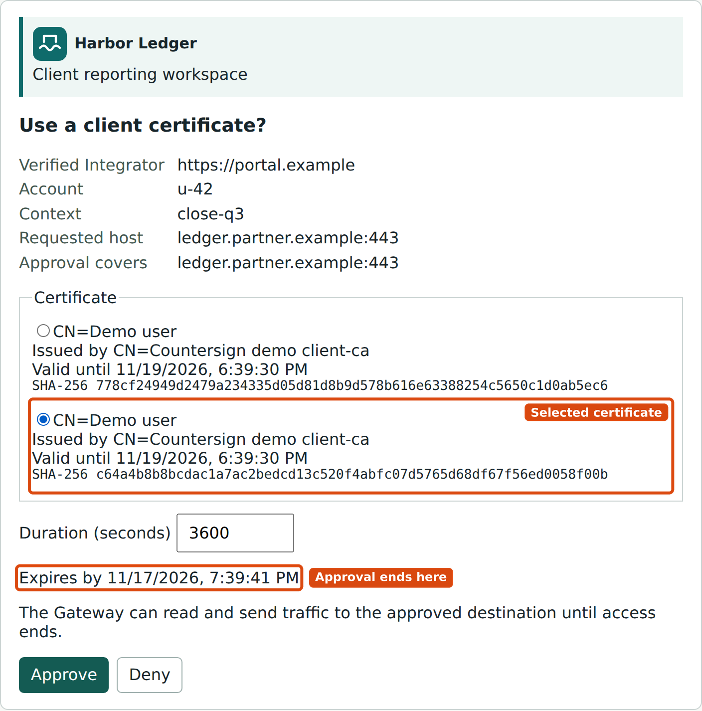

<h1><picture>
  <source media="(prefers-color-scheme: dark)" srcset="docs/assets/wordmark-white.svg">
  
</picture></h1>

Give a remote job temporary access to an HTTPS service that requires a client certificate installed on your desktop. You choose the certificate, destination scope, and duration in the Companion. Your machine signs the TLS handshake. Your Integrator’s Gateway completes it and can read the traffic.



**[Try it with curl](https://zeroae.github.io/countersign/try/).** Pair the Companion with the demo Integrator, pick one of the installed certificates, and compare its fingerprint with the one returned by the mTLS site. The demo runs its services and curl in Docker Compose. The Companion runs on your Linux desktop.

## Use Countersign

Run `npx @zeroae/countersign` to open the desktop installer on Windows or macOS, or launch the AppImage on Linux. npm selects the x64 or ARM64 binary for the running Node process.

| If you… | Start here |
|---|---|
| Received a pairing or approval request | [Install and use the Companion](https://zeroae.github.io/countersign/companion/) |
| Own the application that starts jobs for users | [Integrate your service](https://zeroae.github.io/countersign/integrate/) |
| Add pairing and approval controls to a page | [Web widget integration](https://zeroae.github.io/countersign/reference/widget/) |
| Run the Gateway and Broker | [Self-host and operate](https://zeroae.github.io/countersign/operate/) |
| Need to know where keys and plaintext go | [Architecture and trust diagram](https://zeroae.github.io/countersign/architecture/) |
| Need evidence for a particular OS, provider, or installer | [Tested platforms](https://zeroae.github.io/countersign/reference/support/) |

## How the handshake works

[](https://zeroae.github.io/countersign/architecture/)

Each Integrator hosts its own Broker and Gateway. Solid arrows carry the job's traffic. Dashed arrows carry authorization and signing messages. One desktop Companion can pair with several Integrators. The default Gateway runs beside one Workload. A shared Gateway is also available for Linux hosts.

## Read the handbook locally

From the checkout, run:

```sh
python3 -m venv .venv
.venv/bin/python -m pip install -r requirements-docs.txt
.venv/bin/python -m mkdocs serve
```

Open the local address printed by MkDocs. For native builds, installers, and the local conda package, see [Develop and release](https://zeroae.github.io/countersign/develop/).

## License

[MIT](LICENSE), copyright 2026 Zero A.E., LLC.
