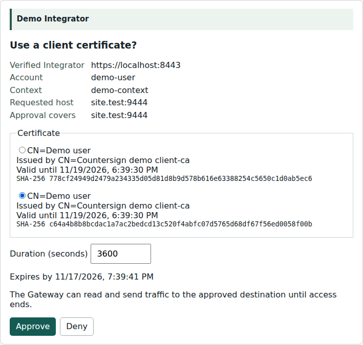
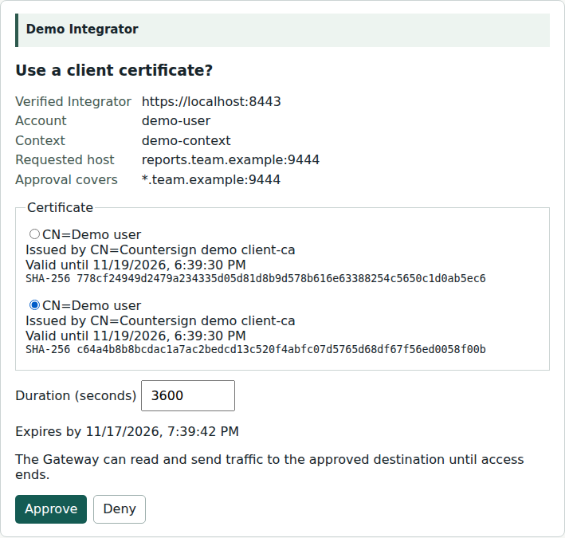

# Use the Companion

Install the Companion on the computer that already holds your client certificate. Your remote job can then ask this computer to authenticate to a website. Pair each Integrator once. When a request arrives, you decide which certificate the job may use, where it may use it and for how long.

## Install the Companion

Choose the desktop artifact for your operating system and processor from the distribution run. Each archive contains the installer and a separate native addon for developers. The installer already includes its matching addon. These builds are unsigned. [Installer artifacts](https://github.com/zeroae/countersign/actions/runs/44195966471/attempts/2) · [Tested platforms](reference/support.md)

| Desktop | Package | Where the Companion finds your website certificate |
|---|---|---|
| Windows | Run the per-user `.exe` installer and open **Countersign** from Start. | The current user's Personal certificate store, backed by a CNG signing key. |
| macOS | Open the `.pkg` installer, then open **Countersign** from Applications. | A Keychain identity whose private key is accessible to Security.framework. |
| Linux | Install the `.deb` with your package manager, or make the `.AppImage` executable and launch it in your desktop session. | A PKCS#11 token available through p11-kit or the configured module. Unlock your encrypted login keyring before pairing. |

Enable **Start at login** if this computer should receive requests after sign-in. Open the window again from the tray using **Open Countersign**. Linux users can also [build and install the local conda package](develop.md#install-with-conda-on-linux).

## Pair an Integrator

1. Get the Integrator's HTTPS origin from your signed-in service. Enter the full origin, including a nonstandard port, in **Integrator origin** and choose **Pair**.
2. In the browser, check the origin, sign into the intended account and enter the code displayed by your Companion.
3. Back in the Companion, check the verified origin, account and code before choosing **Confirm pairing**. The Integrator appears under **Paired Integrators**. A second Integrator gets its own pairing and connection.

The two confirmation screens are illustrated in the [demo walkthrough](try.md#pair-the-desktop). If a paired Integrator changes its logo, name, copy or colours, review the old and new appearance under **Review branding change**. Choose **Accept new branding** to adopt it. The verified origin and approval controls belong to the Companion.

## Decide what to approve

Open the local notification, choose **Open Companion** on the Integrator's site, or open the tray app. Read the verified origin and account first, then check that the Context corresponds to the job you started. **Requested host** identifies the immediate connection. **Approval covers** describes every destination the job can reach with this grant.

The Companion lists the eligible installed certificates. With **two or more**, you must select one before **Approve** becomes available. Use the issuer, expiry and SHA-256 fingerprint to distinguish identical names. With one eligible certificate, it is selected and still needs your approval. If none qualify, you can deny or resolve the provider issue. Only the selected public chain is sent to the Broker.

Enter the duration in seconds and check **Expires by**. The initial default is one hour, subject to the administrator's limit and the selected certificate's expiry. Approval lets this job use the certificate for further handshakes within that scope and duration. A native provider may separately prompt to unlock a key or token.

### Read a wildcard approval

In this example, the job requested `reports.team.example:9444`. The administrator enabled approval for the whole `*.team.example:9444` entry. That can also cover `archive.team.example:9444` under the same policy. The apex, deeper names and other ports fall outside this scope. The normal setting even for a wildcard entry is an approval for the single requested host.

Choose **Deny** if the scope is wider than you intended. The Integrator can request access again after it changes the policy. If several desktops receive an offer, the first committed decision settles it for all of them. An approved grant uses the identity on the desktop that won the request.

## End access or remove a computer

| Action | What happens |
|---|---|
| Close the window | The Companion stays in the tray and continues to receive requests and sign approved handshakes. |
| Choose **Quit** in the tray | New handshakes require the approving desktop to reconnect. Established traffic can continue while its leases renew, up to the grant's expiry. |
| Choose **Revoke access** on an approval | The Companion queues the revocation and shows when the Broker records it. From that point outstanding traffic has at most its existing lease budget. |
| Choose **Remove from this computer** | Deletes this computer's pairing key and local state. Use the Integrator's device controls to end the remote pairing and grants. |
| Choose **Revoke pairing at Integrator** | Opens the verified Integrator's device-management page. Select the pairing to forget. You can also use that page from another computer if this one is lost. |

If another Companion connects to your account, its entry includes connection information and a device ID. Review the ID before choosing **Disconnect device** or **Disconnect all other devices**. Removing another device revokes its grants. An independent lease deadline bounds the remaining traffic. [How revocation works](architecture.md#when-access-ends)

## When an approval doesn't work

| What you see | What to check |
|---|---|
| No desktop notification | Open **Approval requests**, then check the connection for the specific Integrator. A web notification or deep link locates a pending request. It cannot approve one. |
| No eligible installed certificate | Check that the identity is valid for client authentication, has its private key, and matches the issuer and signature schemes allowed for this destination. Ask the Integrator which identity it expects. |
| Provider unavailable | Unlock the native provider and reconnect the token if applicable. On Linux verify that p11-kit can see the token in the same login session. Request access again. |
| Approved, but the job still cannot connect | Look for **Ready for handshakes** on the approving desktop. If the original connection attempt timed out, retry it from the job. The Integrator can distinguish an approval from an accepted upstream handshake. |
| Revocation queued | Reconnect to the verified Integrator and use **Retry revocation**. If the desktop cannot reconnect, revoke through the Integrator. The lease cutoff starts from the Broker's recorded decision. |
