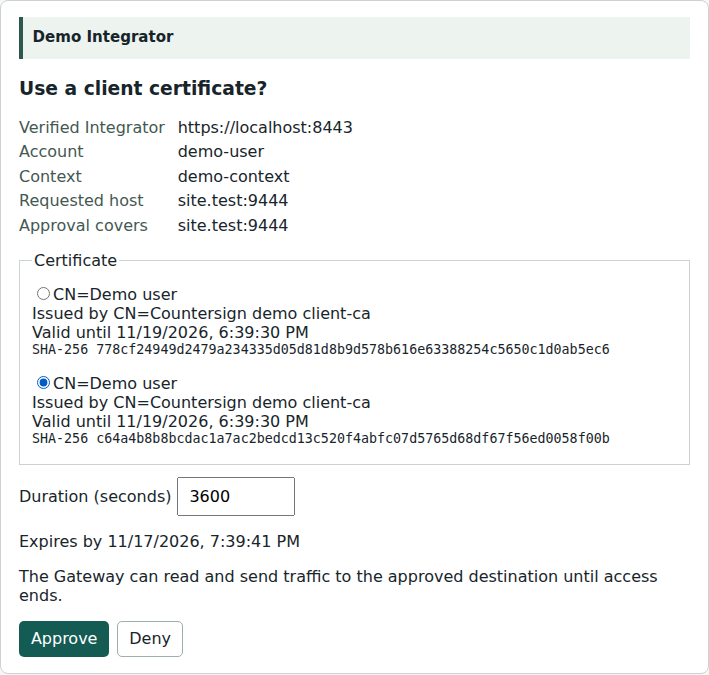
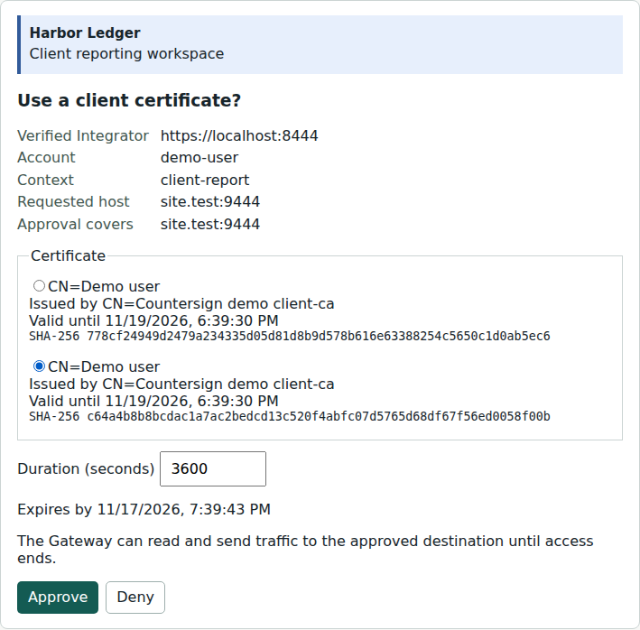

# Web widget and Companion branding

The `@countersign/widget` workspace package registers `<countersign-widget>`. In a pnpm workspace containing the package, use `"@countersign/widget": "workspace:*"` and bundle it into the authenticated page for a Context. For a standalone site, the demo shows how to serve the three ES modules from your own origin. [Widget implementation](https://github.com/zeroae/countersign/blob/fbb5aa7c951f8b70a238f3351140aa44a6184adf/packages/widget/src/widget.js) · [Demo page](https://github.com/zeroae/countersign/blob/fbb5aa7c951f8b70a238f3351140aa44a6184adf/examples/demo-integrator/site/app.js)

## Connect the adapter

```html
<countersign-widget></countersign-widget>
<p id="pair-instructions" role="status"></p>
```

The following page module uses the example Integrator's session contract. `/api/session` returns the signed-in user's CSRF token and optional public VAPID key. The `/api/*` routes belong to your application. Their handlers check the session, Origin, CSRF token and Context before calling the [Broker API](api.md).

```js
import { subscribeForPush } from "@countersign/widget";

const widget = document.querySelector("countersign-widget");
const response = await fetch("/api/session", { credentials: "same-origin" });
if (!response.ok) throw new Error("Sign in to this Context first.");
const session = await response.json();

async function post(action, body = {}) {
  const res = await fetch("/api/" + action, {
    method: "POST",
    credentials: "same-origin",
    headers: {
      "Content-Type": "application/json",
      "X-CSRF-Token": session.csrf
    },
    body: JSON.stringify(body)
  });
  if (!res.ok) throw new Error("Request failed (" + res.status + ")");
  return res.status === 204 ? null : res.json();
}

const adapter = {
  pair() {
    document.querySelector("#pair-instructions").textContent =
      "Open Countersign, choose Pair, and enter " + location.origin;
  },
  async connect() {
    const { id } = await post("connect");
    return id;
  }
};

if (session.vapid && "serviceWorker" in navigator && "PushManager" in window) {
  adapter.subscribe = async () => {
    if (await Notification.requestPermission() !== "granted") {
      throw new Error("Notification permission was declined.");
    }
    await navigator.serviceWorker.register("/sw.js", { type: "module" });
    await subscribeForPush(await navigator.serviceWorker.ready, session.vapid,
      subscription => post("subscribe", { subscription }));
  };
}
widget.adapter = adapter;
```

| Member | Contract |
| --- | --- |
| `adapter.pair()` | Required. Guides the user into pairing. The Companion starts enrollment and opens the authenticated browser confirmation page. |
| `adapter.connect()` | Required. Resolves to the **ID string** of the account's request. The widget then exposes an **Open Companion** link for a user gesture. |
| `adapter.subscribe()` | Optional. Its presence displays **Enable notifications**. Resolve after the backend has saved the subscription. |
| `widget.showRequest(id)` | Displays a launch link for an ID your backend has checked for the signed-in user. Accepted syntax is 22–128 ASCII letters, digits, underscores or hyphens. |
| `widget.adapter = null` | Clears the old launch link and disables the controls. Set this on logout or while switching Contexts. Replacing the adapter also discards late UI results from its predecessor. |

The launch URL is `countersign://approve/<id>`. The Companion matches the hint against its authenticated inboxes and fetches the offer on the matching pairing. A cold start can take time to reconnect. If the browser declines the custom URL, open the installed Companion and review its pending requests. [Desktop behavior](../companion.md)

## Web Push

To enable the fallback, configure the Broker's `web_push` section with its private VAPID key, contact and allowed push-service hosts. Pass the matching public VAPID key to the page. The Broker can send an encrypted JSON string containing an approval ID when the account has a pending initial or retry request and no connected Companion. Surface the ID returned by `renew` through the widget for pending replacements. [Broker configuration](config.md)

Bundle this worker module as `/sw.js`. Its click handler opens a fixed HTTPS page on the Integrator origin with the ID in its fragment.

```js
import { installPushHandlers } from "@countersign/widget/service-worker";
installPushHandlers(self, "/");
```

On that page, after sign-in and adapter setup, retrieve the current request before offering the launch link.

```js
const id = new URLSearchParams(location.hash.slice(1)).get("countersign");
if (id) {
  const status = await post("status", { id });
  if (status.state === "pending" && status.id === id) widget.showRequest(id);
}
```

On logout, remove the subscription through the authenticated backend while the account session is still active, then call the browser subscription's `unsubscribe()`. The demo performs both steps. [Notification handler](https://github.com/zeroae/countersign/blob/fbb5aa7c951f8b70a238f3351140aa44a6184adf/packages/widget/src/service-worker.js) · [Demo logout handler](https://github.com/zeroae/countersign/blob/fbb5aa7c951f8b70a238f3351140aa44a6184adf/examples/demo-integrator/integrator.js)

## Style the web controls

`--countersign-font` sets the widget font and `--countersign-accent` sets the launch-link color. The component exposes `actions`, `launch` and `status` shadow parts. Page styles apply inside the browser.

```css
countersign-widget {
  --countersign-font: system-ui, sans-serif;
  --countersign-accent: #235a44;
}
countersign-widget::part(status) { margin-block: .5rem; }
```

## Brand the Companion prompt

Serve a UTF-8 JSON manifest at `https://<integrator-origin>/.well-known/countersign.json`. The Companion fetches it without cookies. If you include a logo, make its URL accessible on that same HTTPS origin without redirects.

```json
{
  "version": 1,
  "displayName": "Finance workspace",
  "copy": "Quarterly reconciliation",
  "logo": "/assets/finance.png",
  "colors": { "accent": "#235a44", "background": "#f3f8f5" }
}
```

| Field | Accepted value |
| --- | --- |
| `version`, `displayName` | Version `1` and display name up to 80 UTF-16 code units. |
| `copy` | Optional text up to 240 UTF-16 code units. Text fields reject control and format characters. |
| `colors.accent`, `colors.background` | Optional six-digit hex colors. Defaults are `#164e63` and `#ffffff`. |
| `logo` | Optional relative or absolute same-origin PNG URL up to 1,024 UTF-16 code units. The download limit is 128 KiB and each dimension is at most 512 pixels. |

The manifest has an 8 KiB limit. The Companion stores accepted branding with its pairing. A changed manifest appearance or changed logo image is presented for review. The user can keep the old appearance. On first pairing, an unavailable or invalid manifest leaves the verified origin visible with neutral branding. [Theme validation](https://github.com/zeroae/countersign/blob/fbb5aa7c951f8b70a238f3351140aa44a6184adf/packages/companion/src/theme.js)





Compare the branding area in the two prompts. The verified origin, exact host and approval scope, selected certificate, duration and **Approve**/**Deny** controls are drawn by the Companion.
