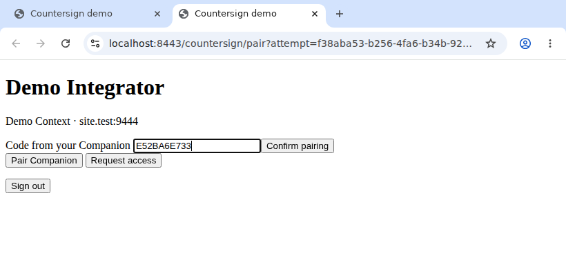
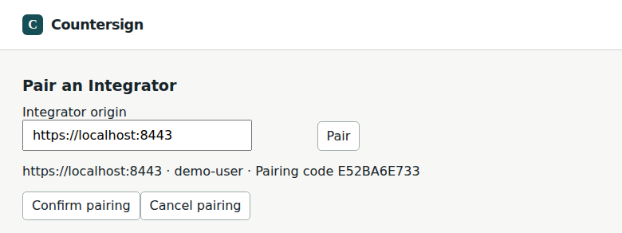
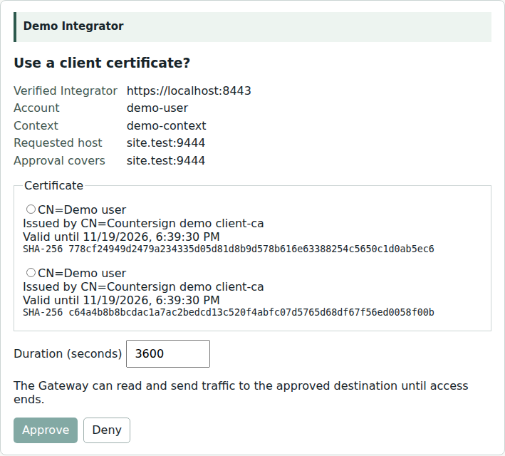

# Try Countersign with curl

In this walkthrough, curl runs in a container and calls `https://site.test:9444/`. The site requires a client certificate. The desktop holds the candidate identities. You can verify exactly which certificate the site received, then revoke the grant and try the same request again.

## Start the local demo

Use a Linux desktop session and a regular user with Docker Compose access. Have the [packaged Linux Companion](companion.md#install-the-companion) or an [unpacked build](develop.md#build-the-companion) available. The launcher uses D-Bus, GNOME Keyring, libsecret tools, SoftHSM2, Chromium, and Python. On Ubuntu 24.04 the desktop prerequisites include `dbus-daemon`, `gnome-keyring`, `libsecret-tools`, `softhsm2`, `libnss3-tools`, `apparmor-utils`, and `python3-venv`.

Run from the repository root:

```sh
python3 -m venv .venv
.venv/bin/pip install -r examples/demo-integrator/test/fixture-requirements.txt
.venv/bin/python -m playwright install chromium
.venv/bin/python examples/demo-integrator/compose_demo.py \
  --app /absolute/path/to/countersign-companion
```

Replace the app path with your executable. If you have Chromium installed, you can skip the Playwright browser download and pass `--browser /absolute/path/to/chromium`. The launcher creates a disposable token, keyring, browser profile, and Companion profile. It builds the service images and prints the Integrator origin and the path to a temporary login secret. On Ubuntu hosts that restrict user namespaces, it requests sudo to load a temporary AppArmor profile for the demo and removes it on exit.

## Pair the desktop

1. Enter the printed HTTPS origin in the Companion’s **Integrator origin** field. Choose **Pair**.
2. In the browser tab opened by the Companion, sign in with the temporary secret from the printed file. Enter the pairing code shown in the Companion and choose **Confirm pairing**.

   

3. In the Companion, check that the origin and account belong to this demo. Choose **Confirm pairing**. The paired Integrator should show **Connected**.

   

## Choose a certificate and verify it

Type `curl` at the launcher's prompt. The Workload already has the proxy address and the public sidecar CA. The first request waits while you decide.



Read **Verified Integrator**, **Context**, **Requested host** and **Approval covers**. Choose one certificate, note its SHA-256 fingerprint, set the duration in seconds, and choose **Approve**. The site obtains the certificate from the authenticated TLS connection and returns its fingerprint. A capture from the demo returned:

```json
{"fingerprint":"c64a4b8b8bcdac1a7ac2bedcd13c520f4abfc07d5765d68df67f56ed0058f00b","subject":"Demo user"}
```

Each launch creates fresh certificates. Compare the response to the fingerprint you selected in **your** run. Matching subject names alone cannot identify the key that signed the handshake.

## End access

Choose **Revoke access** under the approval in the Companion. Wait for **Broker recorded revocation**, then type `curl` again. A new connection from that Workload should fail. An explicit **Request access** from the Integrator starts a fresh approval. Type `quit` at the launcher prompt to remove the demo containers and disposable local state.

If the request stalls, first look for **Connected** in the Companion, then for a pending request under **Approval requests**. An empty certificate list points to desktop identity discovery. A request that fails after approval needs a check of upstream trust and certificate acceptance. [Companion troubleshooting](companion.md#when-an-approval-doesnt-work) · [Integrator troubleshooting](integrate.md)
